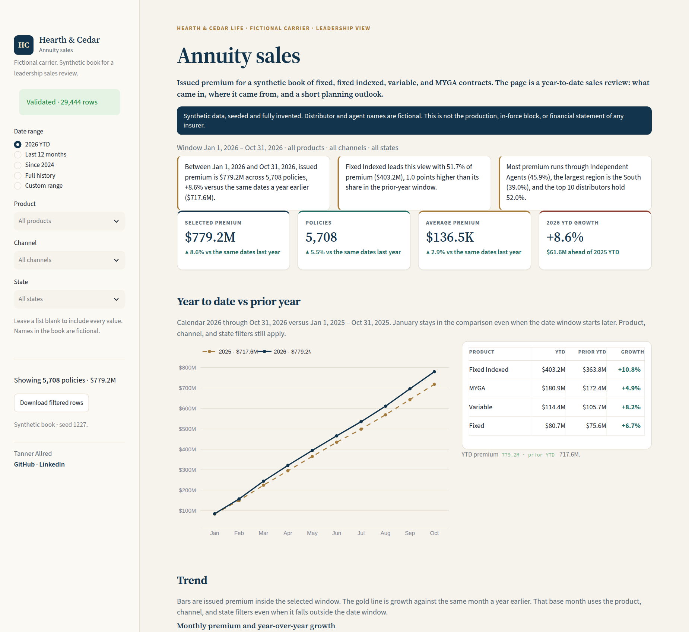
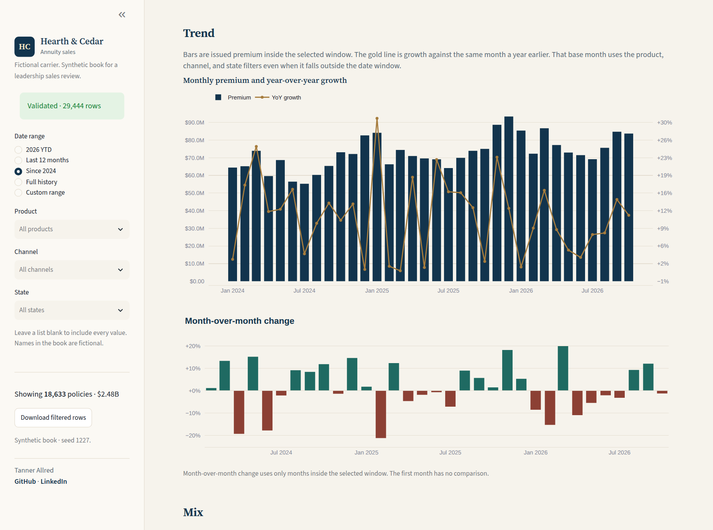
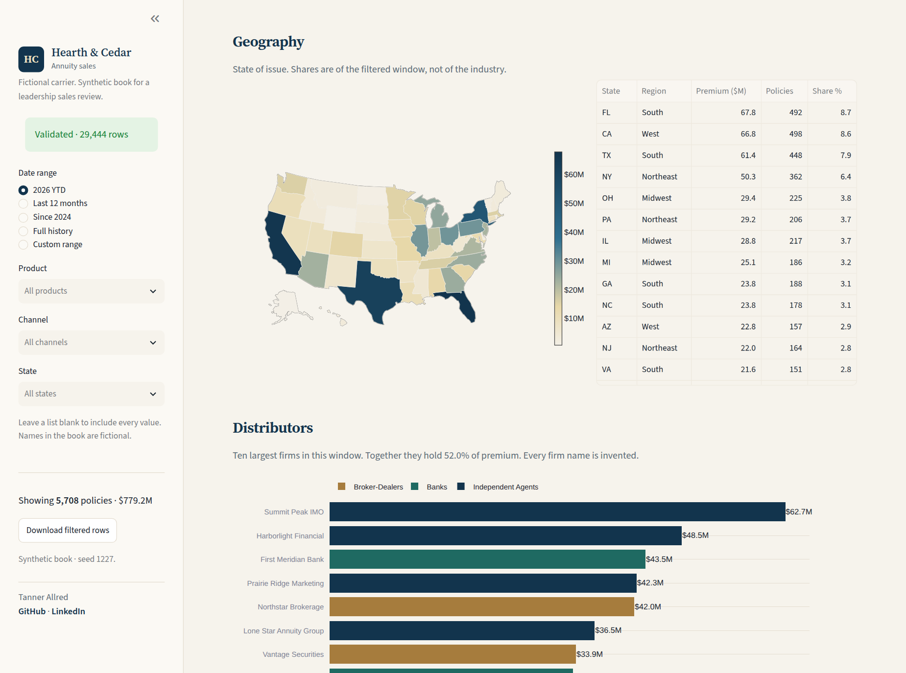
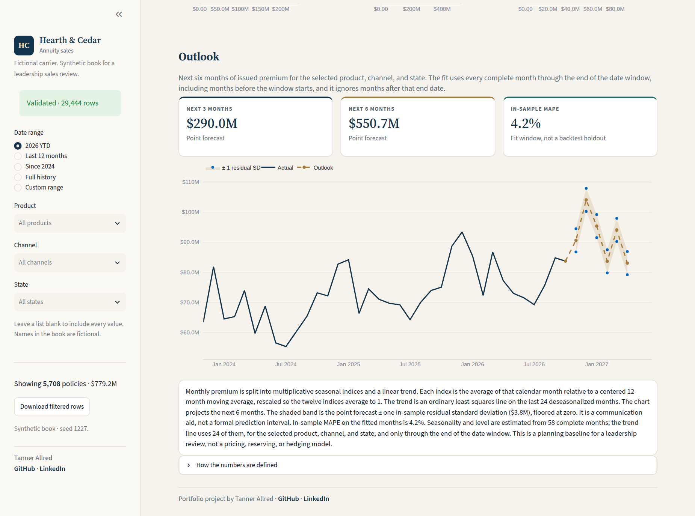

# Annuity sales dashboard

A year-to-date sales review for a fictional carrier, **Hearth & Cedar Life**. It is a portfolio project: the book, the distributors, and the agents are synthetic, seeded, and labeled as such on the page. Nothing here is an insurer's production, in-force block, or financial statement.

The question the page is built to answer is the one leadership asks of a sales report. How much premium has been issued this year, compared with the same dates last year? Which products, channels, and states are carrying the book, and what do the next six months look like if the recent seasonal pattern holds?

I'm Tanner Allred, a data analyst working in Python, statistics, and insurance reporting. [GitHub](https://github.com/tannerman1227) · [LinkedIn](https://www.linkedin.com/in/tanner-allred)

## What the page shows



2026 year-to-date issued premium on the default view is **$779.2M** across **5,708** policies, **+8.6%** versus the same dates in 2025. Fixed indexed annuities are a little over half the book.



The date control also opens a longer window. Since 2024 the book is **$2.48B**, and each month is drawn against the same month a year earlier.





## Business problem

Annuity sales reviews get messy fast. Premium, policy count, and average size move differently. Fixed, fixed indexed, variable, and multi-year guaranteed (MYGA) annuities are sold through different channels, and a calendar year-to-date comparison is easy to misalign with a partial prior year. This dashboard keeps those definitions in one place: a selected window, a matched prior-year window, and a calendar year-to-date view that always starts in January.

## Features

- KPI cards for issued premium, policy count, average premium, and calendar year-to-date growth.
- Cumulative year-to-date premium versus the same dates last year, with product-level growth.
- Monthly trend with year-over-year growth, plus month-over-month change.
- Mix by product, channel, and region, and premium by product within channel.
- U.S. map and state table, top distributors, annuitant age band, tax status, and MYGA guarantee period.
- Filters for date range (presets and a custom range), product, channel, and state. An empty list means all values.
- A six-month outlook. Month-of-year indices come from a centered 12-month moving average, and the level is an ordinary least-squares line on the last 24 deseasonalized months. The band is ± one in-sample residual standard deviation. It is a planning baseline, not a prediction interval and not a pricing or reserving model.
- Schema, range, and referential checks on the book, shown in the sidebar.
- Download of the filtered rows.

## Tech stack

Python, pandas, NumPy, Plotly, and Streamlit. Tests run with pytest. The app is a single Streamlit entry point, so it can be deployed on [Streamlit Community Cloud](https://streamlit.io/cloud) without a paid host: connect the repo, set the main file to `app.py`, and leave the committed CSV in place.

## How to run

Python 3.12 is what this repo was built and tested with.

```bash
python -m venv .venv
source .venv/bin/activate
pip install -r requirements.txt
streamlit run app.py
```

The sales file is already in `data/annuity_sales.csv`. Regenerate it, then run the tests:

```bash
python -m src.data_gen
pytest
```

On Streamlit Community Cloud, `requirements.txt` and `runtime.txt` are picked up automatically. No secrets are required.

## Project structure

```
app.py                  Streamlit layout and filters
src/constants.py        Product, channel, state, and fictional distributor catalog
src/data_gen.py         Seeded synthetic book
src/validation.py       Schema, range, and referential checks
src/metrics.py          Filters, KPIs, mixes, year-to-date, monthly series
src/forecast.py         Seasonal outlook
src/insights.py         Short written read of the current view
src/charts.py           Plotly figures
src/formatting.py       Currency, percent, and date labels
data/annuity_sales.csv  Generated book committed so the app runs immediately
tests/                  Metric, forecast, validation, and chart tests
docs/screenshots/       Images in this README
```

## Data note

Every row is synthetic. The generator uses NumPy's Generator with seed **1227** and the NumPy version pinned in `requirements.txt`, which is what makes `data/annuity_sales.csv` reproducible. Policies run from January 2022 through October 2026. Products are fixed, fixed indexed, variable, and MYGA. Channels are independent agents, banks, and broker-dealers. Distributor names, agent ids, and the carrier name are invented.

Premium is issued premium for one contract, in dollars. It is not account value and it is not annualized. Variable contracts use guarantee year 0 because they do not have a multi-year rate guarantee. The shape of the book is deliberate and documented in `src/constants.py`: fixed indexed is the core product, banks write a large share of MYGA, variable premium sits mostly with broker-dealers, and production is lighter in summer and heavier late in the year.

This is not data from American National, Group 1001, or any other company.
